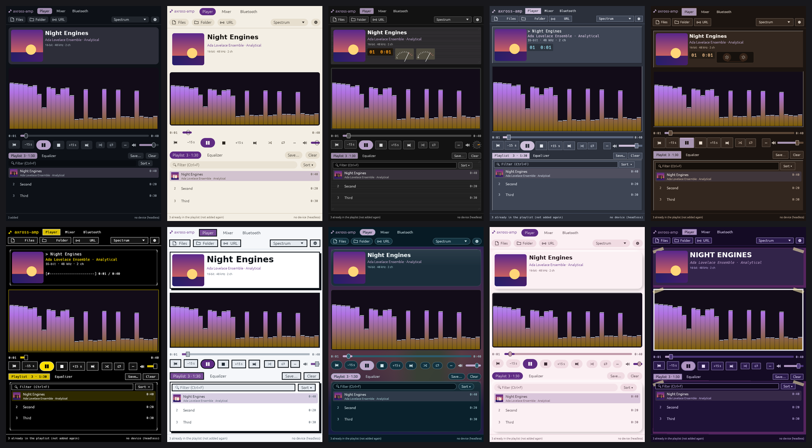
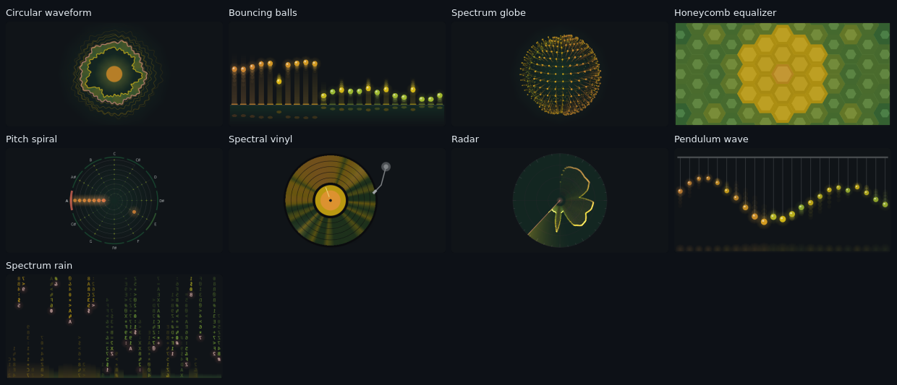

# axross-amp

axross's Media Player as a program of its own - written in Rust.


- **Plays almost anything** - MP3, FLAC, Ogg Vorbis, Opus, AAC / M4A, ALAC, WAV, AIFF, CAF, folders, M3U / PLS and internet radio
- **Truly gapless** - not a sample of silence between an album's tracks; an optional crossfade that never cuts into an album
- **Bit for bit at unity gain** - ReplayGain, a ten-band equalizer, true-peak limiters, a band-limited resampler
- **69 visualizations** - all eighteen of axross's classic faces, eight analysis tools, 34 generative ones, nine spectra and scopes
- **Guarded against flashes** - every face measured by WCAG 2.3.1 / 2.3.2 and ITU-R BT.1702, a flash guard at the output
- **Ten designs** - Modern, Zen, Hi-fi rack, 90s desktop, Cassette deck, Terminal, Brutalist, Glass, Soft, Collage
- **Twelve themes** - design tokens, contrast tested to WCAG AA (AAA in High contrast), follows the desktop's light or dark
- **Show on display** - the pictures full screen on a TV or projector, the sound moved to its HDMI or DisplayPort output
- **Mixer and Bluetooth built in** - the sound server's devices and applications, pairing and connecting headsets
- **At home on the desktop** - MPRIS media keys (Linux), one instance, the state shared with axross, and updates from the signed GitHub releases (Options › Check for updates…)

## Contents

- **Everything in detail: [Extended README](docs/README-extended.md)**
- [Screenshots](#screenshots)
- [Install](#install)
- [Quick start](#quick-start)
- [Documentation](#documentation)
- [Building](#building)
- [Licence](#licence)

> **Photosensitivity warning.** The visualizations move with the music. They
> are guarded against flashes, red flashes and patterns, but the pictures are
> not guaranteed safe for everyone. If you or anyone watching has epilepsy or
> feels unwell, turn the pictures off (⚙ → Off). *Calm* motion is the default;
> *Intense* asks first. What is measured and what is not claimed:
> [Photosensitivity](docs/FLASH_SAFETY.md).

## Screenshots

<table>
  <tr>
    <td></td>
    <td></td>
  </tr>
  <tr>
    <td></td>
    <td></td>
  </tr>
  <tr>
    <td></td>
    <td></td>
  </tr>
  <tr>
    <td></td>
    <td></td>
  </tr>
</table>

<sub>The track in the pictures is a demo synthesized for them (`docs/make_demo.py`);
how each picture is made: [Extended README](docs/README-extended.md),
[Faces](docs/FACES.md#the-face-sheets), [Themes](docs/THEMES.md), [Designs](docs/DESIGNS.md).</sub>

## Install

Each [release](https://github.com/c0decave/axross-amp/releases) has the files
and their `SHA256SUMS`:

- **Linux (x86_64)** - `axross-amp-VERSION-x86_64.AppImage` (`chmod +x` it and run it; from a terminal it goes to the background, `--foreground` keeps it there) or the `linux-x86_64.tar.gz`
- **macOS** - `axross-amp-VERSION-macos-universal.dmg` (the app, Apple silicon and Intel) or the `.tar.gz` (not notarised: the first time, System Settings → Privacy & Security → Open Anyway - on macOS 15 and later the right-click way is gone - or `xattr -d com.apple.quarantine` on it once)
- **Windows (x64)** - `axross-amp-VERSION-windows-x64.zip` (not signed: SmartScreen asks once)
- **From source** - see [Building](#building)

Each archive carries `LICENSE`, `THIRD_PARTY_LICENSES.md` and (Linux) the
desktop entry and icon. Requirements and details: [Install](docs/README-extended.md#install). What changed:
[CHANGELOG](CHANGELOG.md).

**Updates** (from 0.15.0): *Options › Check for updates…* fetches a newer
release's file for this program from GitHub and puts it in place - only
when its `SHA256SUMS` is signed by the release key pinned in the program
and the file has the signed SHA-256. It looks at the start and once a day
(not on an offline or metered network) and says when one is out - or, when
chosen, puts it in place by itself, never restarting the player, its first
start watched; or not at all. A new installation says when one is out; a
player updated from 0.15 keeps 0.15's choice (off unless ticked). A player
before 0.15.0 is updated by hand once. Details:
[Updates](docs/README-extended.md#updates).

## Quick start

```sh
axross-amp                          # the last playlist
axross-amp ~/Music/album/           # add a folder and play it
axross-amp https://example.org/radio.mp3
```

Space plays and pauses, V changes the face, D shows the pictures on another
display, F11 is full screen. All keys and options: [Use](docs/README-extended.md#use).

**Graphics.** The window is drawn by the GPU through wgpu. With an integrated
and a dedicated GPU, *Auto* takes the integrated one on a machine with a
battery (a player sits on one for hours) and the dedicated one on a machine
without (Linux and Windows say which it is; elsewhere the integrated one); a
software adapter only where there is no GPU. *Options › Graphics* (Auto, Power
saving, High performance) chooses and names the adapter in use; the choice is
taken at the next start. With *Power saving* on a desktop the shader faces are
slower on a 4K monitor than the dedicated card would draw them. The
environment decides instead of the setting, and a start whose graphics cannot
be set up names these variables:

| Variable | What it does |
|---|---|
| `WGPU_BACKEND` | the backends asked at all: `vulkan`, `gl`, `metal`, `dx12` (several with commas) |
| `WGPU_ADAPTER_NAME` | the adapter whose name holds this (any case), e.g. `WGPU_ADAPTER_NAME=nvidia` |
| `WGPU_POWER_PREF` | `low` (the integrated GPU) or `high` (the dedicated one) |
| `AMP_GPU_SHADERS` | `1` / `0`: the shader faces by the GPU's shaders or drawn by the CPU, whatever was measured at the start |

**A laptop with two GPUs (Linux: Optimus, PRIME).** The integrated GPU draws
the desktop and an OpenGL program sees only it - with no Vulkan loader
installed (wgpu then draws with OpenGL), *High performance* had no
dedicated adapter to choose. Where the setting wants the dedicated GPU (High
performance, or Auto on a machine without a battery), the player reads
`/sys/class/drm` (each GPU's vendor, which one drew the boot screen, its
driver; an AMD APU and an AMD card told apart by their memory) and asks for
it the way its driver wants, before any graphics start: NVIDIA's own driver
with `__NV_PRIME_RENDER_OFFLOAD=1`, `__GLX_VENDOR_LIBRARY_NAME=nvidia`,
`__VK_LAYER_NV_optimus=NVIDIA_only` (and NVIDIA's EGL vendor file), a Mesa
driver (nouveau, amdgpu, radeon) with `DRI_PRIME=1`. Variables you set
yourself are left as they are. A window the dedicated GPU cannot give is
made again at once on the integrated one (from a terminal, by the copy in
the background too). Options › Graphics says what was done, and
`axross-amp --adapters` lists every adapter by API, the one the window would
draw with and the note - to paste into a bug report. Installing the Vulkan
loader (Debian and Ubuntu: `libvulkan1`, Fedora: `vulkan-loader`, Arch:
`vulkan-icd-loader`) lets wgpu see both GPUs by Vulkan.

**Titles in other scripts.** Chinese, Japanese, Korean, Arabic, Hebrew, Thai
and Devanagari are written with the system's fonts (found in the background,
each file checked before it is used); right-to-left titles read from the
right. `AXROSS_AMP_FONTS` names further font files or folders of them
(separated as `PATH` is), asked first.

## Documentation

| Page | What it covers |
|---|---|
| [Extended README](docs/README-extended.md) | everything in detail: features, install, use and keys, build, status, tests |
| [Faces](docs/FACES.md) | the 69 visualizations, their colour schemes and options, the face sheets |
| [Designs](docs/DESIGNS.md) | the ten window designs and how they are tested |
| [Themes](docs/THEMES.md) | the twelve window themes and their contrast checks |
| [Show on display](docs/DISPLAY.md) | the pictures on a monitor of their own, with the sound |
| [Photosensitivity](docs/FLASH_SAFETY.md) | the flash guard, the readings, the measurements, what is not claimed |
| [Known limitations](docs/LIMITATIONS.md) | what does not hold or is not supported yet |
| [Changelog](CHANGELOG.md) | what changed in each version |

## Building

```sh
cargo build --release               # target/release/axross-amp
cargo test                          # needs a Vulkan device (Mesa's lavapipe works without a GPU)
```

On Linux the ALSA headers are needed (`libasound2-dev`); libopus is built from
its sources, which needs CMake. Desktop entry, icon and more:
[Build](docs/README-extended.md#build).

## Licence

Apache-2.0, as axross.
