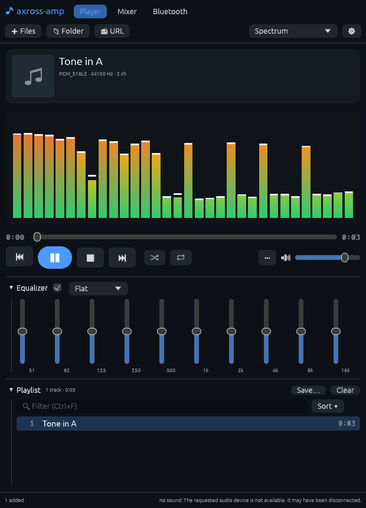
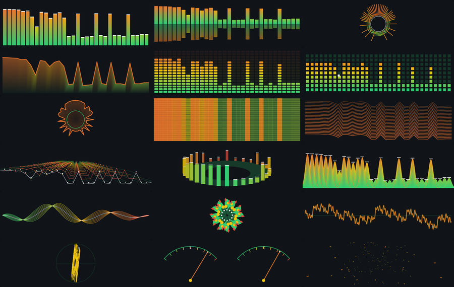
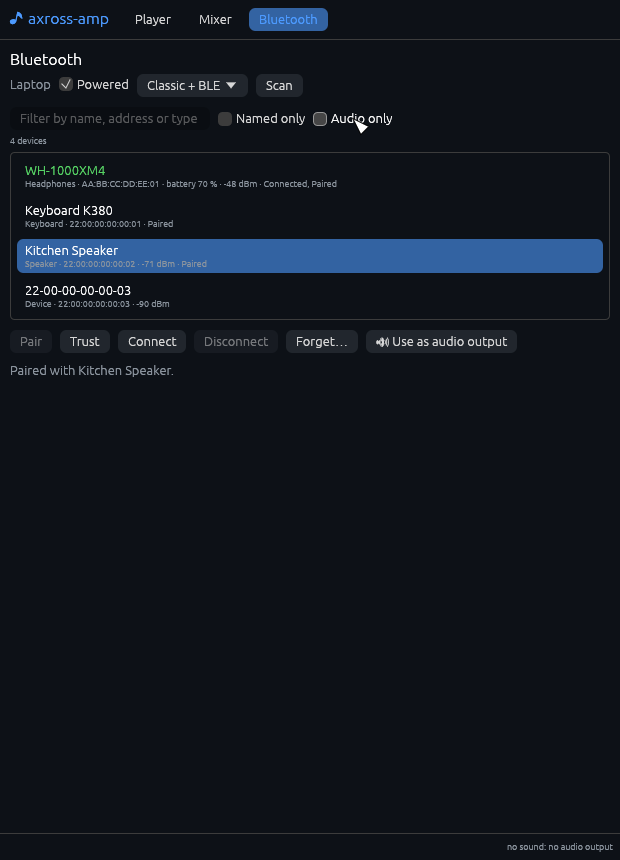

# axross-amp

axross's Media Player as a program of its own - written in Rust.



- **Plays** local files (MP3, FLAC, Ogg Vorbis, Opus, AAC / M4A, ALAC, WAV, AIFF, CAF;
  MP4 / MKV containers), folders and M3U / PLS playlists, and **internet radio** by
  its http(s) URL - decoded by [symphonia](https://github.com/pdeljanov/Symphonia)
  (Opus by libopus, built in), played through [cpal](https://github.com/RustAudio/cpal)
  (PulseAudio / PipeWire or ALSA on Linux, CoreAudio on macOS, WASAPI on Windows).
- **Gapless**: the next track is opened before the current one ends and decoded on
  into the same buffer - not a sample of silence between the tracks of an album;
  AAC / ALAC in MP4 are trimmed by their edit list (encoder delay and padding).
- **Sound**: resampled to the output's rate by a band-limited (windowed-sinc)
  resampler; 5.1 / 7.1 downmixed as ITU-R BS.775 has it; **ReplayGain** (track or
  album gain, pre-amp, held below the peak; Opus R128 gains too); a ten-band
  **equalizer** with axross's presets; a volume curve as axross's. An output that
  goes away (a headset switched off) is opened again; one chosen that is not there
  gives way to the default.
- **Internet radio**: what the station plays now (ICY `StreamTitle`), its name and
  genre; a radio that breaks off is connected again; a `.pls` / `.m3u` URL from a
  radio directory is resolved (only its http(s) entries); old SHOUTcast servers
  (`ICY 200 OK`) play. The network is read on threads of its own: a server that
  stalls holds up nothing.
- **Visualizations** drawn on the GPU (egui) - all eighteen of axross's: spectrum,
  mirrored, radial and polar spectrum, line spectrum, LED equalizer, particle
  columns, waterfall, ridgelines, spectrum terrain, 3D ring, bell curves, wave
  ribbon, kaleidoscope, oscilloscope, stereo scope, VU meters, starfield - in
  axross's colour schemes (Classic, Fire, Ice, Neon, Mono, Follow the theme,
  Custom - edited here), with its options (bars, smoothing, peak fall, frame
  rate). A click shows the next face, a double-click makes it large, F11 full
  screen, a right click its menu.
- **Playlist**: shuffle (Previous goes back the way it came), repeat (all / one), a
  filter (Ctrl+F), sorting (title, file name, folder, length, reversed), reordering
  by dragging or by keys, drag and drop of files and folders from the desktop
  (walked in the background), saving as M3U8. Titles and lengths are read in the
  background; a track that cannot be played is marked red with why; the details of
  a track (tags, format, ReplayGain) in a window of their own.
- **Sleep timer** (15 to 90 minutes with a fade, or at the end of the track).
- **The desktop** (Linux): MPRIS 2 on the session bus - media keys, a headset's
  buttons, the desktop's sound menu and lock screen show and control it. The window
  title says what plays; the window opens as large as it was left.
- **The system mixer** (Mixer tab): this player's output device, volume, mute and
  equalizer; the sound server's outputs and inputs (volume, balance kept, mute, port,
  default), the applications playing and recording (volume, mute, which device) and
  the cards' profiles (a Bluetooth headset: A2DP or headset) - through `pactl` of
  PulseAudio or PipeWire, live as they change elsewhere; volumes follow a slider
  while it is dragged.
- **Bluetooth** (Bluetooth tab, Linux): the adapter (power, scan for Classic and / or
  BLE devices), the devices with kind, battery, signal and state; Pair, Trust,
  Connect, Disconnect, Forget - through BlueZ on the system D-Bus
  ([zbus](https://github.com/dbus2/zbus)). A pairing that asks (confirm a passkey,
  type a PIN) asks in a dialog; nothing is accepted without an answer. **Use as audio
  output** connects a speaker or headset and makes its output this player's.
- **Shares its state with axross**: the playlist, the track and its position, the
  volume, the visualization (`~/.config/axross/media_player.json`) and axross's one
  equalizer (`~/.config/axross/audio.json`) - the player inside axross and this
  program pick up where the other left off. Keys they do not know are kept. What
  only this program has (window size, ReplayGain) is in
  `~/.config/axross/axross-amp.json`, as axross rewrites its own file with its keys.



<p> </p>

## Use

```sh
axross-amp                          # the last playlist
axross-amp ~/Music/album/           # add a folder and play it
axross-amp list.m3u song.flac
axross-amp https://example.org/radio.mp3
```

Keys (on the Player tab, not while typing in a field):

| Key | |
|---|---|
| Space | play / pause |
| ← / → | seek 5 s (Shift: 30 s); Ctrl: previous / next track |
| ↑ / ↓, + / − | volume |
| Home | the track's start |
| M, N, P | mute, next, previous |
| V, F11 | the next visualization; full screen (Escape leaves) |
| Ctrl+F | the playlist's filter |
| Ctrl+↑ / ↓, Alt+↑ / ↓ | choose a track in the playlist; move it |
| Enter, Delete | play the chosen track; remove it |

The mouse wheel seeks over the position and sets the volume over its slider.

## Build

```sh
cargo build --release               # target/release/axross-amp
cargo test                          # the window test renders it (needs a Vulkan device;
                                    # Mesa's lavapipe works without a GPU)
```

On Linux the ALSA headers are needed (`libasound2-dev`); PulseAudio / PipeWire is
spoken natively. libopus is built from its sources, which needs CMake.

## Status

This is the Rust rewrite of the Python `axross-amp` (written out of
[axross](https://github.com/c0decave/axross) by `scripts/export_standalone.py amp`).
The three tabs of the Python version are here, and its player's features but for
those named below; on top of them: gapless playback, ReplayGain, MPRIS, ICY titles and
reconnecting radios, a playlist filter and sorting, background reading of titles and
lengths, track details.

What stays in axross's Bluetooth panel only: the map of devices by distance, the
presence log, HCI capture streams, GATT details, connection tests and driving a USB
stick directly (Bumble). Left out on purpose: crossfading (it fights gapless albums),
playback speed and A-B loops, lyrics and scrobbling (none of them in axross either);
a visualization detached into a window of its own (full screen and the large view
cover it); choosing several playlist rows at once (one at a time here); axross's
check that the sound card plays at its speed; its session's theme and language;
tracks dropped from axross's remote panes (axross's own business). On
macOS and Windows the Bluetooth tab points to the system's settings (BlueZ is
Linux's) and there is no MPRIS (media keys there would need the platform's own APIs);
the Mixer tab needs `pactl` (Linux, or a PulseAudio elsewhere).

Tests: `cargo test` runs everywhere. The window is driven headless (egui_kittest,
wgpu - Mesa's lavapipe works without a GPU); the engine's sound is taken by the
tests themselves sample by sample (gapless joins, streams from local HTTP servers
that stall, break off, carry ICY titles); with `AMP_CORPUS` (a folder made by
`make.py` with PyAV) every format is played through ALSA's file plugin and measured.
The mixer and Bluetooth tests run against axross's fakes when they are given -
`AMP_FAKE_PACTL=axross/tests/fake_pactl.py`, `AMP_FAKE_BLUEZ=axross/tests/fake_bluez.py`
(on a private `dbus-daemon`) and `AMP_PYTHON` (a Python with jeepney); MPRIS runs on
a private `dbus-daemon` of its own. Without them those tests pass, saying so.

## Licence

Apache-2.0, as axross.
