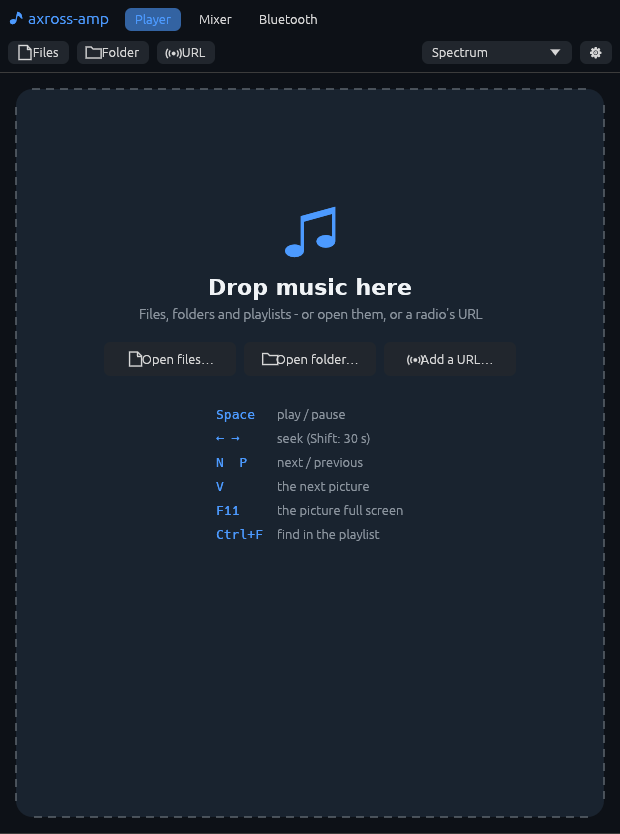

# axross-amp

axross's Media Player as a program of its own - written in Rust.


<sub>The track in the picture is a demo synthesized for it (`docs/make_demo.py`); the
picture is made by `AMP_DEMO_TRACK=… cargo test --test ui -- --ignored`.</sub>

- **Plays** local files (MP3, FLAC, Ogg Vorbis, Opus, AAC / M4A, ALAC, WAV, AIFF, CAF;
  MP4 / MKV containers), folders and M3U / PLS playlists, and **internet radio** by
  its http(s) URL - decoded by [symphonia](https://github.com/pdeljanov/Symphonia)
  (Opus by libopus, built in), played through [cpal](https://github.com/RustAudio/cpal)
  (PulseAudio / PipeWire or ALSA on Linux, CoreAudio on macOS, WASAPI on Windows).
- **Gapless**: the next track is opened before the current one ends and decoded on
  into the same buffer - not a sample of silence between the tracks of an album;
  AAC / ALAC in MP4 are trimmed by their edit list (encoder delay and padding).
- **Sound**: resampled to the output's rate by a band-limited (windowed-sinc)
  resampler; 5.1 / 7.1 downmixed as ITU-R BS.775 has it; **ReplayGain** (track or
  album gain, pre-amp, held below the peak, a gain of its own for untagged tracks;
  Opus R128 gains too); a ten-band **equalizer** with axross's presets; a volume curve
  as axross's; pause, seek, stop and a new track fade (no clicks), and so does a
  dropout's edge. At unity gain the samples go out bit for bit (a master peaking just
  under full scale is not bent); a track ReplayGain makes louder goes through a
  look-ahead true-peak limiter (-1 dBTP, 4 ms ahead, its gain eased in and out)
  instead of clipping. The output has one too, always in the path (4 ms later, bit
  for bit where it holds nothing back), holding the peaks at -0.3 dBTP wherever the
  sound may go over full scale: a track resampled to the output's rate (its peaks
  between samples become samples), two tracks summed in a crossfade, the equalizer
  raising a band. The output's finds the peaks between samples 8x oversampled (a
  64-tap windowed sinc; it reads clipped, bright masters right where BS.1770's 4x
  filter reads them up to 0.8 dB low), aims 0.5 dB under its ceiling, holds from
  0.3 s before a crossfade, and where it holds nothing it neither looks nor scans:
  its cost is a copy. An optional **crossfade** (1 to 12 s, off by default) fades a
  track into the next - its law following how alike the two are (equal power for
  unrelated tracks, equal amplitude for alike ones: the level stays) - never inside
  an album, which stays gapless: tagged, the album (and album artist) decides;
  untagged, two files of one folder numbered one after the other ("01 ...", "02
  ..." or track numbers) are an album's; a flat folder of unrelated files fades. Each
  track keeps its own ReplayGain; the meters count the new track from the fade's
  middle. Masters that themselves go 3-4 dB over full scale between their samples
  are held at the ceiling in a fade at the cost of ~3 dB of level there (a gain
  limiter cannot do otherwise without clipping; outside the fade they play bit for
  bit). Optionally a track chosen while
  another plays fades in over it for a second. The output callback takes no lock and
  allocates nothing (a lock-free ring;
  a test counts its allocations through a real device); files are read and decoded
  seconds ahead on threads of their own, so a slow disk or a stalled network share is
  no dropout. A small output buffer is asked for (1024 frames); the position and the
  pictures follow what the speakers play, not what was decoded.
  An output that goes away (a headset switched off) is opened again; one chosen that is
  not there gives way to the default; without any, nothing pretends to play and the
  window offers Retry.
- **Internet radio**: what the station plays now (ICY `StreamTitle`), its name and
  genre; a radio that breaks off is connected again; a `.pls` / `.m3u` URL from a
  radio directory is resolved (only its http(s) entries); old SHOUTcast servers
  (`ICY 200 OK`) play. The network is read on threads of its own: a server that
  stalls holds up nothing (a read gives up after 20 s; a stream let go closes its
  connection at once). HLS (`.m3u8` with segments) is not supported and says so.
- **The window** is laid out round the picture: what plays on a card tinted with the
  cover's colour (title, artist and album in a type scale of their own; the accent of
  the whole window comes from the cover, kept readable), the picture large - as large
  as a short playlist leaves room for - and below it the playlist (two lines a track,
  the playing one with its cover and bars that move with the sound) or the equalizer
  (a dB scale, each band filled from its 0 dB line). The card's cover is 120 to 200
  px as the window allows; the cover (kept up to 1024 px) is made the size it is
  shown at, in pixels, on a thread of its own by a Lanczos filter and cropped to a
  square (egui's renderer makes no mipmaps: made smaller by the GPU it aliased).
  The "Cover" face makes the cover the picture, glowing with the bass (without a
  cover, a record in the scheme's colours). The pictures' colours come from the
  cover too, when it has some (or a scheme of axross's, below): not its colours
  mixed (that made browns and olive greys) but a ramp designed in OKLCH round its
  main hue - and its second, where it has one - lightness rising evenly, a floor of
  chroma; the pictures are dithered (no bands in slow gradients). Nothing to play: a drop zone with
  Open files, Open folder, Add a URL and the keys. Paused, the picture stands still;
  changing faces fades one into the next.
- **Visualizations**, 49 of them in three groups:
  - *Classic* - all eighteen of axross's, drawn as axross draws them (its geometry,
    colours and constants; [side by side](docs/axross-and-amp.png)): spectrum,
    mirrored, radial and polar spectrum, line spectrum, LED equalizer, particle
    columns, waterfall, ridgelines with their sun, spectrum terrain, 3D ring, bell
    curves, wave ribbon, kaleidoscope, oscilloscope, stereo scope, VU meter,
    starfield. Two differ by default: the waterfall is smooth, at high resolution (256
    log bands of the fine spectrum, as foobar2000's spectrogram; axross's bars are an
    option), and the two scopes find their gain (quiet or near-mono music still fills
    them). Trails and glow for the starfield and the stereo scope are an option.
  - *Analysis* - a spectrum analyzer (8192-point FFT, a held peak curve, the
    strongest peak with its note and cents, the note and level under the pointer),
    a loudness meter after EBU R128 (momentary, short-term, integrated with both
    gates, loudness range, true peak by BS.1770's own filter, the last minute, a
    target of -23, -16 or -14 LUFS), phase and stereo width (correlation, width,
    balance, the last ten seconds), a goniometer with a phosphor's persistence, the
    track's waveform (read in the background; a click goes there), a chromagram with
    the circle of fifths and the whole track's key (with how sure, "?" until then), a
    piano roll (notes found at two resolutions, harmonics told from notes) and a mel
    spectrogram in magma.
  - *Generative* - the cover, liquid (domain-warped noise), fire, metaballs, aurora,
    flow field, synthwave, a tunnel of glowing lines, galaxy, Julia set (smooth escape
    colours, orbit traps), reaction-diffusion, a feedback face in MilkDrop's manner
    (its last frame warped under a new layer; five looks of its own, a new one each
    phrase of 16 beats - it reads no MilkDrop presets), a flyover of a raymarched night landscape the bass lifts, crystals
    (Voronoi cells), a skyline (searchlights, traffic, roofs lit by their bands),
    isometric bars, DNA helix, spirograph, polygon morph, moiré (antialiased), beat
    rings, smoke and the title's words on the beat.

  The loudness, the true peak, the beat and the notes are measured on a thread of
  their own from every sample played - minimised, on another tab or with the picture
  off too. The pixel faces are WGSL shaders run through egui's wgpu renderer. Where
  the renderer is slow (a software rasterizer such as llvmpipe: measured at the start,
  by the CPU time a face costs either way) the window is drawn at most 12 times a
  second, fewer where a frame costs more (a large window: down to 3), so that it
  takes about 0.6 of a core; the cover face 4 times; the shader faces in at most
  about 90,000 pixels, scaled up, or by a thread of the player's own per pixel,
  whichever measured cheaper. At rest nothing is drawn (no frames, no work) and the
  last picture stays. The picture is analysed once a
  frame for all faces, and neither that nor most faces allocate in a frame; the
  pictures move alike at any frame rate. In axross's colour schemes (Classic, Fire,
  Ice, Neon, Mono, Follow the theme, Custom - edited here), with its options (bars,
  smoothing, peak fall, frame rate). A click shows the next face (Shift+V the one
  before), a double-click makes it large (its title kept above it, with "Show the
  playlist" - the list under the picture - and "Normal size"; Escape too), F11 full
  screen, a
  right click its menu with every face at a glance; "Off" draws nothing.
- **Playlist**: shuffle (Previous goes back the way it came), repeat (all / one), a
  filter (Ctrl+F), sorting (title, artist, album with its discs and track numbers,
  file name, folder, length, reversed; names in natural order), several rows at once
  (Ctrl- / Shift-click) to remove or drag, reordering by keys, **play next** (from a
  row's menu; queued rows are marked), **undo** of a removal, clearing, sorting or
  reordering (Ctrl+Z), drag and drop of files and folders from the desktop (walked in
  the background; a file already in the list is not added twice), saving as M3U8. Titles,
  lengths, artists and albums are read in the background; a track that cannot be
  played is marked red with why; the details of a track (tags, format, ReplayGain) in
  a window of their own. At most 10,000 tracks - axross's player reads no more.
- **Sleep timer** (15 to 90 minutes with a fade, or at the end of the track).
- **The desktop** (Linux): MPRIS 2 on the session bus - media keys, a headset's
  buttons, the desktop's sound menu and lock screen show and control it, also while
  the window is minimised. One player: a second start hands its files over. A desktop
  entry and an icon are in `packaging/`. The window title says what plays; the window
  opens as large as it was left.
- **The system mixer** (Mixer tab): this player's output device, volume, mute and
  equalizer; the sound server's outputs and inputs (volume, balance kept, mute, port,
  default), the applications playing and recording (volume, mute, which device) and
  the cards' profiles (a Bluetooth headset: A2DP or headset) - through `pactl` of
  PulseAudio or PipeWire, live as they change elsewhere; volumes follow a slider
  while it is dragged.
- **Bluetooth** (Bluetooth tab, Linux): the adapter (power, scan for Classic and / or
  BLE devices), the devices with kind, battery, signal and state; Pair, Trust,
  Connect, Disconnect, Forget - through BlueZ on the system D-Bus
  ([zbus](https://github.com/dbus2/zbus)). A pairing that asks (confirm a passkey,
  type a PIN) asks in a dialog; nothing is accepted without an answer. **Use as audio
  output** connects a speaker or headset and makes its output this player's.
- **Shares its state with axross**: the playlist, the track and its position, the
  volume, the visualization (`~/.config/axross/media_player.json`) and axross's one
  equalizer (`~/.config/axross/audio.json`) - the player inside axross and this
  program pick up where the other left off. Keys they do not know are kept. What
  only this program has (window size, ReplayGain, crossfade, the cover's colours, the face options) is in
  `~/.config/axross/axross-amp.json`, as axross rewrites its own file with its keys.
  Files are written on a thread of their own, merged with what axross's player wrote
  meanwhile (its playlist is not undone by a change of volume here).


<sub>From the demo track, played in real time by `cargo test --test ui -- --ignored`
(see above); the sheets are made by `docs/faces_sheet.py`.</sub>

<p> </p>

<p></p>

## Photosensitivity

The pictures move with the music, and moving, flashing pictures can bring
on seizures in people with photosensitive epilepsy - some of whom do not
know it. axross-amp is made so that no picture flashes more than three times
in any second (WCAG 2.3.1), nor flashes in saturated red (2.3.2):

- **The flash guard.** What drives a picture's brightness - every bar, the
  beat's pulse, the VU meter, the oscilloscope's height - may turn from
  rising to falling (or back) no sooner than a quarter of a second after it
  last turned, and it moves there smoothly, never jumping within a frame: at
  most two flashes a second. Beats move, scale and colour the pictures; no
  picture brightens as a whole on the beat. The fire's flames lick slowly and
  are orange rather than saturated red.
- **Calm by default.** Motion is *Calm* (the generative pictures at 70 % of
  their pace). *Intense* (Options) is livelier, after a photosensitivity
  warning, and still turns no sooner than every 0.17 s: under three flashes a
  second. Where the desktop asks for reduced motion (GNOME's animations off),
  Intense cannot be chosen.
- **Tested.** `tests/flash.rs` renders every face and its options at 60 frames
  a second through the worst music for them - a kick at 180 BPM, white noise
  in bursts four times a second, silence and full scale in turn - and follows
  each frame's relative luminance (and saturated red) in every quarter of the
  picture as ITU-R BT.1702 and the Harding test do: more than three flashes in
  any second, or any red flashes over three, fails it. Before the guard ten
  faces flashed four times a second (spectrum, mirror, line, polar, bells,
  scope, VU, fire, aurora, helix) and the fire eight times in red; now at
  most two in Calm and three in Intense, none in red. High-contrast stripes
  (a trigger when they move) are measured and reported too; none of the
  faces covers more than a fifth of the picture with them.

If you or anyone watching is sensitive to flashing light, keep the motion
Calm, watch from a distance in a lit room, or choose a calm face (the cover,
the waterfall, the analysis tools) - or turn the picture off.

## Use

```sh
axross-amp                          # the last playlist
axross-amp ~/Music/album/           # add a folder and play it
axross-amp list.m3u song.flac
axross-amp https://example.org/radio.mp3
```

Keys (on the Player tab, not while typing in a field):

| Key | |
|---|---|
| Space | play / pause |
| ← / → | seek 5 s (Shift: 30 s); Ctrl: previous / next track |
| ↑ / ↓, + / − | volume |
| Home | the track's start |
| M, N, P | mute, next, previous |
| V, Shift+V, F11 | the next / the previous visualization; full screen (Escape leaves) |
| Ctrl+F | the playlist's filter |
| Ctrl+↑ / ↓, Alt+↑ / ↓ | choose a track in the playlist; move it |
| Enter, Delete | play the chosen track; remove it |
| Ctrl+Z | undo the playlist's last change |

The mouse wheel seeks over the position and sets the volume over its slider.

## Build

```sh
cargo build --release               # target/release/axross-amp
cargo test                          # the window test renders it (needs a Vulkan device;
                                    # Mesa's lavapipe works without a GPU)
```

To have it in the desktop's menu and as an "Open with" for audio files (Linux):

```sh
install -Dm755 target/release/axross-amp ~/.local/bin/axross-amp
install -Dm644 packaging/axross-amp.desktop ~/.local/share/applications/axross-amp.desktop
install -Dm644 packaging/axross-amp.svg ~/.local/share/icons/hicolor/scalable/apps/axross-amp.svg
update-desktop-database ~/.local/share/applications   # (where it is installed)
```

One player at a time: a second start (a file opened from the file manager) hands its
files to the one running, over the session D-Bus; `--new-instance` starts another.

On Linux the ALSA headers are needed (`libasound2-dev`); PulseAudio / PipeWire is
spoken natively. libopus is built from its sources, which needs CMake.

## Status

This is the Rust rewrite of the Python `axross-amp` (written out of
[axross](https://github.com/c0decave/axross) by `scripts/export_standalone.py amp`).
The three tabs of the Python version are here, and its player's features but for
those named below; on top of them: gapless playback, ReplayGain, MPRIS, ICY titles and
reconnecting radios, a playlist filter and sorting, background reading of titles and
lengths, track details.

What stays in axross's Bluetooth panel only: the map of devices by distance, the
presence log, HCI capture streams, GATT details, connection tests and driving a USB
stick directly (Bumble). Left out on purpose: playback speed and A-B loops, lyrics
and scrobbling (none of them in axross either);
a visualization detached into a window of its own (full screen and the large view
cover it); axross's check that the sound card plays at its speed; its session's theme and language;
tracks dropped from axross's remote panes (axross's own business). On
macOS and Windows the Bluetooth tab points to the system's settings (BlueZ is
Linux's) and there is no MPRIS (media keys there would need the platform's own APIs);
the Mixer tab needs `pactl` (Linux, or a PulseAudio elsewhere).

Known limits: cpal's PulseAudio back end (cpal 0.18.2, the newest) takes a mutex
after the output callback has returned, to hand the samples over - outside this
player's callback, which itself takes no lock, and out of its hands until cpal
changes it. HLS radio (`.m3u8` segment lists) is not played. On a software renderer
the whole window is drawn by the CPU (llvmpipe: 0.06 to 0.25 s of a core a frame,
more as the window grows): the frame rate is lowered to stay under a core, so a
large window on a software renderer moves at a few frames a second
(`tests/real_window.rs` measures it); at rest it costs about nothing. There was no
GPU of its own to measure on here: the GPU's cost of the faces
(`--ignored` in `tests/faces.rs`) has only been measured on Mesa's lavapipe and
llvmpipe, by the clock.
The beat is found from the onsets; on syncopated music the tempo may read half or
double. The notes below about C2 are not told apart from their neighbours.

Tests: `cargo test` runs everywhere. The window is driven headless (egui_kittest,
wgpu - Mesa's lavapipe works without a GPU); the engine's sound is taken by the
tests themselves sample by sample (gapless joins, streams from local HTTP servers
that stall, break off, carry ICY titles); with `AMP_CORPUS` (a folder made by
`make.py` with PyAV) every format is played through ALSA's file plugin and measured.
The mixer and Bluetooth tests run against axross's fakes when they are given -
`AMP_FAKE_PACTL=axross/tests/fake_pactl.py`, `AMP_FAKE_BLUEZ=axross/tests/fake_bluez.py`
(on a private `dbus-daemon`) and `AMP_PYTHON` (a Python with jeepney); MPRIS runs on
a private `dbus-daemon` of its own. Without them those tests pass, saying so.

The faces are tested from a known signal: every one rendered and measured (how
much it draws, in how many colours, how much it moves), the shaders on the CPU
against the GPU, the cost of a frame at 620 x 300, 1920 x 1080 and 3840 x 2160, the
allocations of a frame counted; the analysis against known signals (a 1 kHz sine at
-18 dBFS reads -18 LUFS, mono correlates +1 and inverted -1, a C major chord lights
C, E and G, clicks at 128 BPM are 128 BPM, an intersample peak is found) and EBU
Tech 3341's cases 1-5, 9-11 and 15-18 and Tech 3342's cases 1-4 synthesised. Not
covered: 3341's case 6 (5.0 - the meter measures what is played, the stereo
downmix), 7, 8, 19-23 and 3342's 5 and 6 (EBU's own recordings, not derivable),
12-14 (their signals could not be checked against the specification here: not
claimed); end to end through the player, the
same integrated loudness shown, hidden, with the picture off and at 3 fps, the meters
starting a new track at its first sound, a chord progression's key and a melody's
notes; the CPU's drawing of the shader faces against the GPU's by SSIM in each colour
channel and by ΔE at the same moment; a hot master bit for bit at unity gain, the
limiter's true peak (measured at 8x: a dense master resampled, two hot masters
crossfaded), a crossfade, a fade when changing track, an album gapless with a
crossfade set (also untagged rips of one folder). In a real window (Xvfb,
`tests/real_window.rs`, also 1200 x 980) the frame rate stays under its cap, on a
software renderer the player takes under a core (`--release`), and at rest under 5 %.
`tests/python_compat.rs` has axross's own Python read and write the shared state file
(`AMP_AXROSS`, `AMP_PYTHON`; it says loudly when it could not).
`docs/axross_faces.py` renders axross's own faces (offscreen Qt) from the same signal
for the comparison sheet. `tests/states.rs` renders the window in each of its states
(also 420 x 420).

## Licence

Apache-2.0, as axross.
