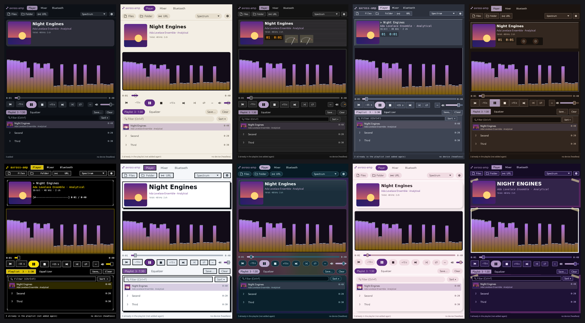

# Designs

Back to the [README](../README.md) - everything in detail: the [extended README](README-extended.md).

**Designs** for the window (⚙ → Design), ten, apart from the themes (any
design in any theme). Each is a layout of its own over the same player -
where the parts go, in what sizes, drawn how (`src/app_layouts.rs`, the
painters in `src/design.rs`):
*Modern* (the default: a card of what plays, the picture large, the
controls, the playlist); *Minimal / Zen* (one column 720 points wide, its
bars too; the cover large in the middle, the picture a quiet band, the keys
without fills or frames); *Hi-fi rack* (units one above the other, brushed
and screwed: a display unit with a fluorescent readout and the picture as
its scope, an amplifier with two VU meters, the volume knob and the
switches, a transport with metal keys named under their symbols, a changer
holding the playlist); *90s desktop* (a compact main strip - a title bar,
the time in an LCD well, a small spectrum, a title moving a character at
a time where it does not fit, tiny
bevelled keys - with the playlist as a panel of its own under it; in a wide
window docked at the strip's right, the picture in a window under the
strip; everything monospace); *Cassette deck* (the cassette with its label,
the picture in its window behind two large reels winding from one to the
other with the track and turning a quarter turn a second while it plays,
a mechanical tape counter, level meters, piano keys with their names, the
playlist on the cassette's card insert); *Terminal* (boxes drawn with lines
and named in their edges, every text monospace, `[ PLAY ]` keys, the
position and the volume as bars of characters - sliders to the keys and
the pointer - no rounded corner anywhere); *Brutalist* (an asymmetric hard
grid: the title huge, the cover square in a 3 px frame, the keys heavy
blocks with their names, the picture a band across, no corners or
shadows); *Glass* (light behind frosted, translucent panes, over a haze of
the cover's colours: in two columns - a tall pane of what plays, the
cover large, the words, the position, the keys and the volume, at the left;
the picture and the playlist's pane at the right; narrow, the pane across
with the cover small beside the words); *Soft* (neumorphic, centred: the
picture pressed in at the top, under it a raised card with the words in
the middle, the position and the keys around a large play key, the
switches and the volume; then the playlist's card); *Collage* (a turned photo of the
cover, the title cut letter by letter from other pages in mixed type, a
sticker, the picture on a torn sheet, the keys on paper scraps along a
strip of tape, the playlist on a ruled page - turned shapes anti-aliased,
never over a control). A click on one in the menu shows and keeps it, in
axross-amp's own file (the window does not change as the pointer or the
keyboard's focus passes over the menu's rows: shown at their pace, the whole
window flashed - review 13; and it changes at most twice a second however
fast one design is clicked after another); the menu works by the keys alone. A test (`tests/designs.rs`) checks every design
at 420 x 420, 800 x 600 and 1920 x 1080: each control of the window -
files, folder, URL, ⚙, the position, previous, 15 s back and on, play,
stop, next, shuffle, repeat, volume, mute, ⋯, the equalizer, save, clear,
the filter, sort, the playlist's first row - inside the window, none over
another, each at least 24 x 24 points (WCAG 2.2's target size; a slider
18 high along its length), and clicked where it is drawn (play, pause,
the 15 s keys, next, previous, shuffle, repeat, the volume by its arrow
keys, mute, stop, a double-click on the playlist's row, the two menus);
and that Tab goes through the controls in the order they are seen (row
by row, left to right; a column after the one at its left). A low window
gives the playlist its rows first: the picture shrinks to a strip, the
rack's amplifier and transport share a unit, the keys share a row; a wide
and low one (at least 800 points wide, under 440 tall) puts the playlist in
a column beside the player instead (Modern, Glass, Soft, the rack, the
cassette, the brutalist, the collage), the picture at least 60 points tall
there (tested at 900 x 400, 1600 x 420 and 1400 x 460). No design writes
words over words (the cassette's low label on one line), nor cuts the
playlist's buttons or durations off (tested in every design at seven
sizes). Text
keeps 4.5 : 1 (7 : 1 in high contrast) on every design's card and on what
its playlist lies on (the changer, the 90s panel, the card insert, the
ruled page) in every theme over 24 cover hues, and on the glass haze and
light (each of their colours taken toward the ground until every word and
the accent reads as on the ground). What moves (the reels, the needles -
which follow the sound with the picture off too, 15 frames a second - the
counter, the moving titles) was put through the flash meter with the picture off
and the loudest test music, the window and its upper part each taken as
the whole screen: 0 by every reading - transitions, the strict reading,
the either-way area, red - and no stripes. A design's own drawing - its
panels, the picture's frame, the readouts, the reels, the needles,
tessellated - takes 0.003 to 0.06 ms a frame at 1920 x 1080
(`tests/frame_cost.rs`; the limit 1 ms) and allocates nothing for its
size: 0 to 32 small allocations a frame (egui's meshes and text), the same
in a 420 x 420 and a 1400 x 900 window (`tests/frame_alloc.rs`).

**What plays, too long for its box,** moves within it so all of it is read
(src/marquee.rs) - the title, the artist, the album, the lines of both:
where it fits it stands; where not, it waits 2 s at its start, moves at a
calm pace (about 2.3 times its type's size in points a second, some 32 at
14 points; a quarter faster in the intense motion), waits 1.5 s at its
end and comes back to its start - by the clock, paused too; from its
start for a new track; held while the pointer is on it, its whole in the
tooltip; its whole given to a screen reader. Each design moves it its own
way: Modern and Glass smoothly on round ("   •   " between its end and
its start), the cut edges fading; Zen, Soft, the cassette's label, the
collage's artist and the display view smoothly there and back, fading;
Brutalist on round, cut hard; the Hi-fi rack's display a cell at a time
on round after blank cells, its unlit segments with it; the 90s strip a
cell at a time with "***" between; the Terminal a cell at a time there
and back. The collage's title, cut from other pages word by word, is laid
on pages turned one after another (each shown two seconds and as long as
its letters take to read, faded into the next). A right-to-left title
starts at the right and moves the way it is read. Reduced motion: nothing
moves - cut to an ellipsis, its whole in the tooltip. A frame is drawn
only while it moves (20 - 30 a second smoothly, about 4 by cells; none
during its waits, none minimised); on a slow renderer (no GPU) every
design moves it in jumps of at most a third of its box, a frame every few
seconds. `tests/marquee.rs` holds every design to it at 620 x 860 and
420 x 420 with a title of 86 letters (its first and last letters each
seen whole over a round, its box running into nothing), and reads it with
both flash meters: 0.

Every design, playing, at 1280 x 800, each in the theme it suggests (`cargo
test --test designs -- --ignored`; each also in `target/screenshots/designs/`).
Two a row: Modern, Zen; Hi-fi rack, 90s desktop; Cassette deck, Terminal;
Brutalist, Glass; Soft, Collage.
