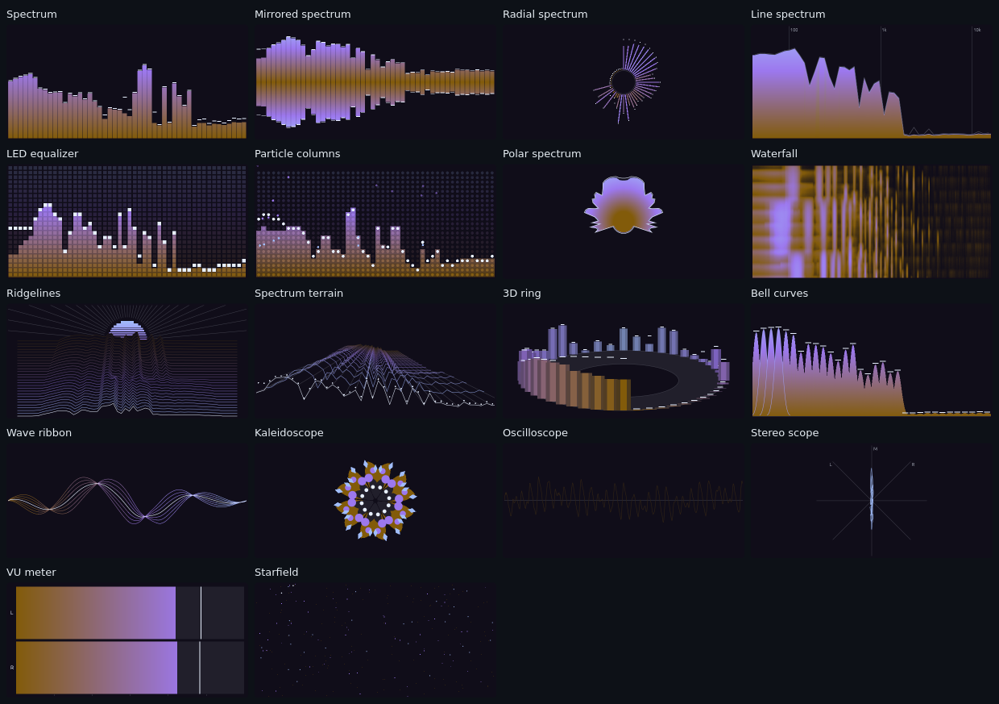
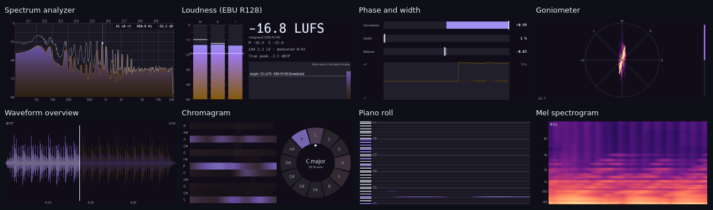
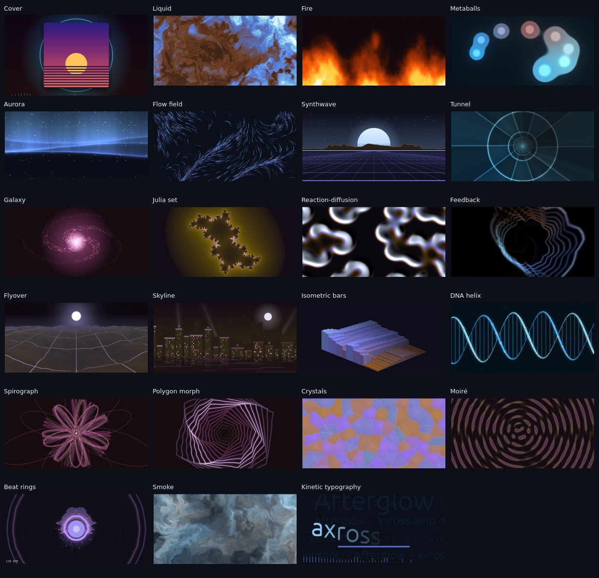

# Faces (visualizations)

Back to the [README](../README.md) - everything in detail: the [extended README](README-extended.md).

> **Photosensitivity warning.** The pictures move with the music; see
> [Photosensitivity](FLASH_SAFETY.md) before watching them.

## The faces

The visualizations, 49 of them in three groups:

- *Classic* - all eighteen of axross's, drawn as axross draws them (its geometry,
  colours and constants; [side by side](axross-and-amp.png)): spectrum,
  mirrored, radial and polar spectrum, line spectrum, LED equalizer, particle
  columns, waterfall, ridgelines with their sun, spectrum terrain, 3D ring, bell
  curves, wave ribbon, kaleidoscope, oscilloscope, stereo scope, VU meter,
  starfield. Two differ by default: the waterfall is smooth, at high resolution (256
  log bands of the fine spectrum, as foobar2000's spectrogram; axross's bars are an
  option), and the two scopes find their gain (quiet or near-mono music still fills
  them). Trails and glow for the starfield and the stereo scope are an option.
- *Analysis* - a spectrum analyzer (8192-point FFT, a held peak curve, the
  strongest peak with its note and cents, the note and level under the pointer),
  a loudness meter after EBU R128 (momentary, short-term, integrated with both
  gates, loudness range, true peak by BS.1770's own filter, the last minute, a
  target of -23, -16 or -14 LUFS), phase and stereo width (correlation, width,
  balance, the last ten seconds), a goniometer with a phosphor's persistence, the
  track's waveform (read in the background; a click goes there), a chromagram with
  the circle of fifths and the whole track's key (with how sure, "?" until then), a
  piano roll (notes found at two resolutions, harmonics told from notes) and a mel
  spectrogram in magma.
- *Generative* - the cover, liquid (domain-warped noise), fire, metaballs, aurora,
  flow field, synthwave, a tunnel of glowing lines, galaxy, Julia set (smooth escape
  colours, orbit traps), reaction-diffusion, a feedback face in MilkDrop's manner
  (its last frame warped under a new layer; eight looks of its own - rings, a
  scope's line, spiral arms, orbits, a rose, spokes, mirrored in two or four -
  a new one each phrase of 16 beats; it reads no MilkDrop presets), a flyover of a raymarched night landscape the bass lifts, crystals
  (Voronoi cells), a skyline (searchlights, traffic, roofs lit by their bands),
  isometric bars, DNA helix, spirograph, polygon morph, moiré (antialiased), beat
  rings, smoke and the title's words on the beat.

The loudness, the true peak, the beat and the notes are measured on a thread of
their own from every sample played - minimised, on another tab or with the picture
off too. The pixel faces are WGSL shaders run through egui's wgpu renderer. Where
the renderer is slow (a software rasterizer such as llvmpipe: measured at the start,
by the CPU time a face costs either way) the window is drawn at most 12 times a
second, fewer where a frame costs more (a large window: down to 3), so that it
takes about 0.6 of a core; the cover face 4 times; the shader faces in at most
about 90,000 pixels, scaled up, or by a thread of the player's own per pixel,
whichever measured cheaper. At rest nothing is drawn (no frames, no work) and the
last picture stays. The picture is analysed once a
frame for all faces, and neither that nor most faces allocate in a frame; the
pictures move alike at any frame rate. In axross's colour schemes (Classic, Fire,
Ice, Neon, Mono, Follow the theme, Custom - edited here; a saturated red ground is
shown darker and turned from red, as on it whatever moves flashes red;
**no face shows a saturated red in any scheme** - Classic's and Fire's own
reds, a cover's, a custom one: each is taken toward a warm white until it
is none, in linear light or as the screen's values; an independent review
had counted red transitions in Classic and Fire, now none), with its options (bars,
smoothing - no less than 75 % -, peak fall - no faster than 100 % a second: at
their extremes the faces flashed -, frame rate). A click shows the next face (Shift+V the one
before), a double-click makes it large (its title kept above it, with "Show the
playlist" - the list under the picture - and "Normal size"; Escape too), F11 full
screen, a
right click its menu with every face at a glance; "Off" draws nothing.
Escape closes only the innermost thing, one at a time: a track's details,
the URL field, the warning or a field being typed in before the large view
or full screen.

## The face sheets

From the demo track, played in real time by `cargo test --test ui -- --ignored`
(as the [window's picture](README-extended.md)); the sheets are made by [`faces_sheet.py`](faces_sheet.py).
