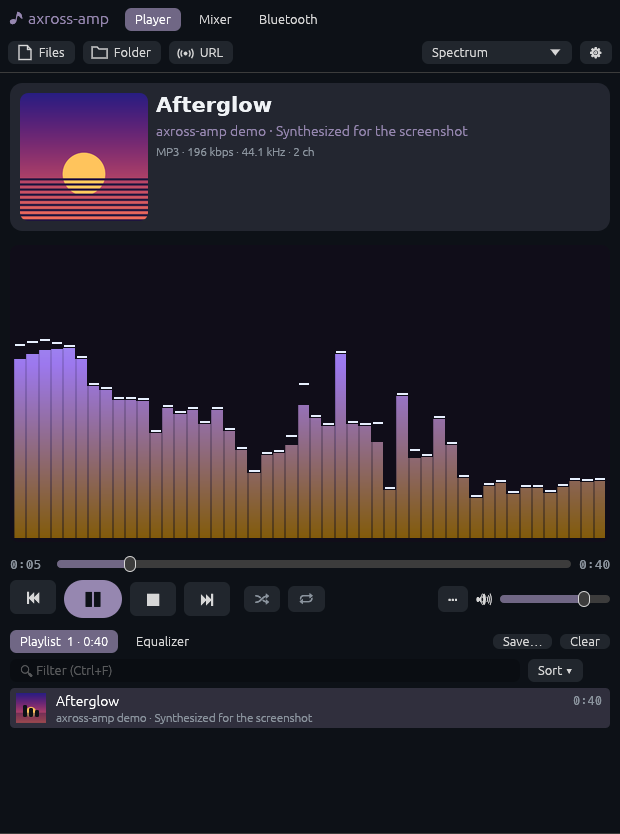
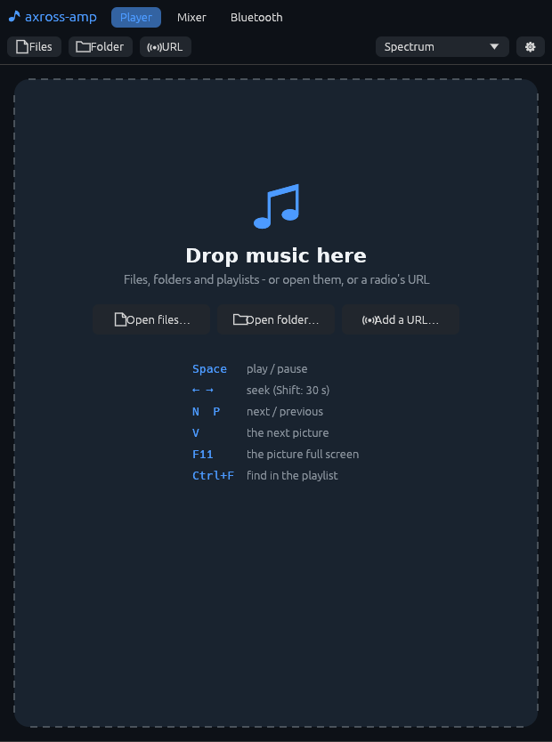
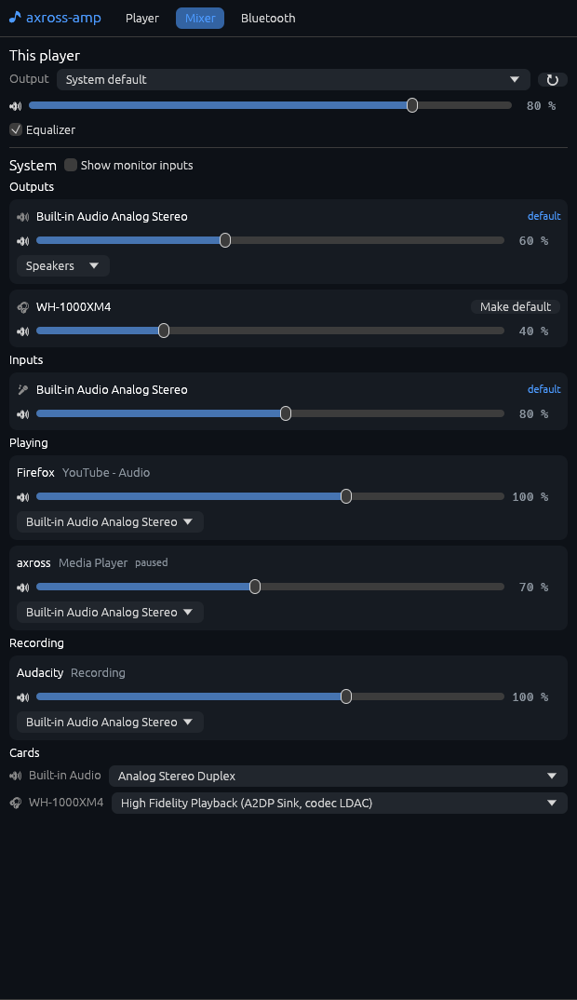
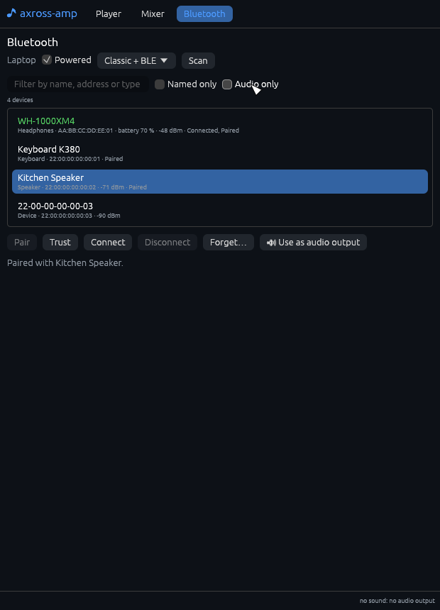

# axross-amp - everything in detail

The full description of axross-amp. The short version is the [README](../README.md);
some topics have a page of their own, linked below.

## Contents

- [Install](#install)
- [Photosensitivity](#photosensitivity)
- [Features](#features)
- [Screenshots](#screenshots)
- [Use](#use)
- [Updates](#updates)
- [Build](#build)
- [Status](#status)
- [Tests](#tests)
- [Licence](#licence)
- Pages of their own: [Faces](FACES.md), [Designs](DESIGNS.md), [Themes](THEMES.md),
  [Show on display](DISPLAY.md), [Photosensitivity](FLASH_SAFETY.md),
  [Known limitations](LIMITATIONS.md), [Releasing](RELEASING.md), [Changelog](../CHANGELOG.md)



<sub>The track in the picture is a demo synthesized for it ([`make_demo.py`](make_demo.py)); the
picture is made by `AMP_DEMO_TRACK=… cargo test --test ui -- --ignored`.</sub>

## Install

Each [release](https://github.com/c0decave/axross-amp/releases) has the files
below and their `SHA256SUMS` (check with `sha256sum -c SHA256SUMS
--ignore-missing`).

Every archive unpacks into a folder of its own, `axross-amp-VERSION-...`,
with the program, its `LICENSE` (Apache-2.0), `THIRD_PARTY_LICENSES.md` (the
licences of every crate it is built from, egui's fonts' too - made from
Cargo.lock for that platform) and the `README.md`.

- **Linux (x86_64)** - `axross-amp-VERSION-x86_64.AppImage`: `chmod +x` it and
  run it (its licences are inside, in `usr/share/doc/axross-amp`; from a
  terminal it goes to the background, as said under [Use](#use)). Or
  `axross-amp-VERSION-linux-x86_64.tar.gz`: the binary, `axross-amp.desktop`
  and `axross-amp.svg` beside it - the binary into `~/.local/bin`, the entry
  into `~/.local/share/applications`, the icon into
  `~/.local/share/icons/hicolor/scalable/apps` (as under [Build](#build)). Built in
  AlmaLinux 9: it needs glibc 2.34 or later (AlmaLinux / RHEL 9, Ubuntu 22.04,
  Debian 12 and later - the release checks it) and ALSA's `libasound.so.2`;
  PulseAudio / PipeWire is spoken natively; the window needs Vulkan or OpenGL
  (any desktop has one of them; without a GPU, Mesa's software drivers) and
  libxkbcommon - under X11 also libxkbcommon-x11 (Debian and Ubuntu:
  `libxkbcommon-x11-0`), which a desktop has; where one is missing the
  program says which and exits.
- **macOS** (Apple silicon and Intel: one universal program) -
  `axross-amp-VERSION-macos-universal.dmg`: `axross-amp.app` to drag to
  Applications; or `axross-amp-VERSION-macos-universal.tar.gz`: the binary.
  Not signed or notarised: the first time macOS refuses it - then System
  Settings → Privacy & Security → Open Anyway (macOS 15 and later; before,
  right-click the app → Open), or `xattr -d com.apple.quarantine` on it
  once.
- **Windows (x64)** - `axross-amp-VERSION-windows-x64.zip`: `axross-amp.exe`
  (a GUI program: no console window), not signed (SmartScreen asks once).
- **From source** - see [Build](#build) (a recent stable Rust; the releases are built with the current one).

From 0.15.0 on each release also carries the program alone for every
system (`axross-amp-VERSION-linux-x86_64`, `-macos-universal`,
`-windows-x64.exe`) and `SHA256SUMS.sig`, the signature of `SHA256SUMS`:
what the player's own update fetches (see [Updates](#updates)).

The Python program this one replaces is on the `python` branch.

## Photosensitivity

> **Photosensitivity warning.** The visualizations move with the music. They
> are calmed at their source and guarded at the output against flashes, red
> flashes and patterns (WCAG 2.3.1 / 2.3.2, ITU-R BT.1702 - see
> [Photosensitivity](FLASH_SAFETY.md) for exactly what is measured and what
> is not claimed), but the pictures are not guaranteed safe for everyone. If you
> or anyone watching has epilepsy or feels unwell, turn the pictures off (⚙ →
> Off). *Calm* motion is the default; *Intense* asks first.

Known limitations (the flash guard's cost on some faces at 60 frames a second among
them) are on a page of their own: [Known limitations](LIMITATIONS.md).

## Features

- **Plays** local files (MP3, FLAC, Ogg Vorbis, Opus, AAC / M4A, ALAC, WAV, AIFF, CAF;
  MP4 / MKV containers), folders and M3U / PLS playlists, and **internet radio** by
  its http(s) URL - decoded by [symphonia](https://github.com/pdeljanov/Symphonia)
  (Opus by libopus, built in), played through [cpal](https://github.com/RustAudio/cpal)
  (PulseAudio / PipeWire or ALSA on Linux, CoreAudio on macOS, WASAPI on Windows).
- **Gapless**: the next track is opened before the current one ends and decoded on
  into the same buffer - not a sample of silence between the tracks of an album;
  AAC / ALAC in MP4 are trimmed by their edit list (encoder delay and padding).
  A seek to the start lands where playing from the start does (an MP3's encoder
  delay dropped once, an Opus file's pre-skip dropped).
- **Chained Ogg** (Vorbis, Opus, FLAC: a new link at each song, as an Icecast
  station sends it and a recording of one keeps it): every link plays, each
  with its own decoder and rate, and an Ogg radio says each song's title; a
  chained file's length is that of all its links and a seek goes into the link
  it falls in. **An MP3 without a Xing header** (VBR, its length only
  estimated from its first frames) plays whole: its frames are counted, its
  length is theirs, a seek goes to its frame. A sample that is no number (NaN,
  infinite) is silence, not the rest of the track; damage in the middle of a
  file ends the track there.
- **Sound**: resampled to the output's rate by a band-limited (windowed-sinc)
  resampler; 5.1 / 7.1 downmixed as ITU-R BS.775 has it; **ReplayGain** (track or
  album gain, pre-amp, held below the peak, a gain of its own for untagged tracks;
  Opus R128 gains too); a ten-band **equalizer** with axross's presets and axross's
  curve (the gains between the bands interpolated over the log of the frequency,
  flat beyond the outer ones - within half a decibel of axross's for its presets,
  by shelves and peaks whose gains are fitted to it, without axross's latency and
  with no level taken off: the output's limiter holds a boost's peaks); a volume curve
  as axross's; pause, seek, stop and a new track fade (no clicks), and so does a
  dropout's edge. At unity gain the samples go out bit for bit (a master peaking just
  under full scale is not bent); a track ReplayGain makes louder goes through a
  look-ahead true-peak limiter (-1 dBTP, 4 ms ahead, its gain eased in and out)
  instead of clipping. The output has one too, always in the path (4 ms later, bit
  for bit where it holds nothing back), holding the peaks at -0.3 dBTP wherever the
  sound may go over full scale: a track resampled to the output's rate (its peaks
  between samples become samples), two tracks summed in a crossfade, the equalizer
  raising a band. The output's finds the peaks between samples 8x oversampled (a
  64-tap windowed sinc; it reads clipped, bright masters right where BS.1770's 4x
  filter reads them up to 0.8 dB low), aims 0.5 dB under its ceiling, holds from
  0.3 s before a crossfade, and where it holds nothing it neither looks nor scans:
  its cost is a copy. An optional **crossfade** (1 to 12 s, off by default) fades a
  track into the next - its law following how alike the two are (equal power for
  unrelated tracks, equal amplitude for alike ones: the level stays) - never inside
  an album, which stays gapless: tagged, the album (and album artist) decides;
  untagged, two files of one folder numbered one after the other ("01 ...", "02
  ..." or track numbers) are an album's; a flat folder of unrelated files fades. Each
  track keeps its own ReplayGain; the meters count the new track from the fade's
  middle. Masters that themselves go 3-4 dB over full scale between their samples
  are held at the ceiling in a fade at the cost of ~3 dB of level there (a gain
  limiter cannot do otherwise without clipping; outside the fade they play bit for
  bit). Optionally a track chosen while
  another plays fades in over it for a second. The output callback takes no lock and
  allocates nothing (a lock-free ring;
  a test counts its allocations through a real device); files are read and decoded
  seconds ahead on threads of their own, so a slow disk or a stalled network share is
  no dropout. A small output buffer is asked for (1024 frames); the position and the
  pictures follow what the speakers play, not what was decoded.
  An output that goes away (a headset switched off) is opened again; one chosen that is
  not there gives way to the default; without any, nothing pretends to play and the
  window offers Retry.
- **Internet radio**: what the station plays now (ICY `StreamTitle`), its name and
  genre; a radio that breaks off is connected again; a `.pls` / `.m3u` URL from a
  radio directory is resolved (only its http(s) entries); old SHOUTcast servers
  (`ICY 200 OK`) play. The network is read on threads of its own: a server that
  stalls holds up nothing (a read gives up after 20 s; a stream let go closes its
  connection at once). HLS (`.m3u8` with segments) is not supported and says so.
- **The window** is laid out round the picture: what plays on a card tinted with the
  cover's colour (title, artist and album in a type scale of their own; the accent of
  the whole window comes from the cover, kept readable), the picture large - as large
  as a short playlist leaves room for - and below it the playlist (two lines a track,
  the playing one with its cover and bars that move with the sound) or the equalizer
  (a dB scale, each band filled from its 0 dB line). The card's cover is 120 to 200
  px as the window allows (wider than 900 points, a hero of up to 320 px on a
  soft shadow, what comes next beside it); the cover (kept up to 1024 px) is made the size it is
  shown at, in pixels, on a thread of its own by a Lanczos filter and cropped to a
  square (egui's renderer makes no mipmaps: made smaller by the GPU it aliased).
  The "Cover" face makes the cover the picture, glowing with the bass (without a
  cover, a record in the scheme's colours). The pictures' colours come from the
  cover too, when it has some (or a scheme of axross's, below): not its colours
  mixed (that made browns and olive greys) but a ramp designed in OKLCH round its
  main hue - and its second, where it has one - lightness rising evenly, a floor of
  chroma; the pictures are dithered (no bands in slow gradients). Nothing to play: a drop zone with
  Open files, Open folder, Add a URL and the keys. Paused, the picture stands still;
  changing faces fades one into the next.
- **Visualizations**, 49 of them in three groups - *Classic* (all eighteen of
  axross's), *Analysis* and *Generative* - how they are drawn, their colour
  schemes and options: [Faces](FACES.md).
- **Show on display** (⚙ → Show on display, or D): the pictures on a monitor
  of their own, the sound with them: [Show on display](DISPLAY.md).
- **Themes** for the window (⚙ → Theme), twelve: [Themes](THEMES.md).
- **Designs** for the window (⚙ → Design), ten: [Designs](DESIGNS.md).
- **The window**: wider than 1240 points the player is a centred column
  1180 wide (Zen: 720). Text on the cover's colour (the chosen row, the buttons) is light
  or dark, whichever reads at 4.5 : 1 or more (WCAG 1.4.3) - tested over 144
  cover hues; the cover's colour is lifted until it does against the ground
  and the cards.
- **Playlist**: shuffle (Previous goes back the way it came), repeat (all / one), a
  filter (Ctrl+F), sorting (title, artist, album with its discs and track numbers,
  file name, folder, length, reversed; names in natural order), several rows at once
  (Ctrl- / Shift-click) to remove or drag, reordering by keys, **play next** (from a
  row's menu; queued rows are marked), **undo** of a removal, clearing, sorting or
  reordering (Ctrl+Z), drag and drop of files and folders from the desktop (walked in
  the background; a file already in the list is not added twice; a file name in
  bytes that are no UTF-8 - Latin-1 on an old disk, from the command line too -
  is kept as it is), saving as M3U8. Titles,
  lengths, artists and albums are read in the background; a track that cannot be
  played is marked red with why; the details of a track (tags, format, ReplayGain) in
  a window of their own. Two or more tracks of one album in a row (one folder) come
  under a header with the album's cover, artist ("Various artists" where they
  differ), its tracks and length. At most 10,000 tracks - axross's player reads no more.
- **Sleep timer** (15 to 90 minutes with a fade, or at the end of the track).
- **The desktop** (Linux): MPRIS 2 on the session bus - media keys, a headset's
  buttons, the desktop's sound menu and lock screen show and control it, also while
  the window is minimised. One player: a second start hands its files over. A desktop
  entry and an icon are in `packaging/`. The window title says what plays; the window
  opens as large as it was left.
- **The system mixer** (Mixer tab): this player's output device, volume, mute and
  equalizer; the sound server's outputs and inputs (volume, balance kept, mute, port,
  default), the applications playing and recording (volume, mute, which device) and
  the cards' profiles (a Bluetooth headset: A2DP or headset) - through `pactl` of
  PulseAudio or PipeWire, live as they change elsewhere; volumes follow a slider
  while it is dragged. Laid out as cards in sections (this player, outputs,
  inputs, applications, sound cards; two columns in a wide window), the
  player's card and the default device in the cover's accent.
- **Bluetooth** (Bluetooth tab, Linux): the adapter (power, scan for Classic and / or
  BLE devices), the devices with kind, battery, signal and state; Pair, Trust,
  Connect, Disconnect, Forget - grouped as connected, paired and nearby, each with
  its kind's sign - through BlueZ on the system D-Bus
  ([zbus](https://github.com/dbus2/zbus)). A pairing that asks (confirm a passkey,
  type a PIN) asks in a dialog; nothing is accepted without an answer. **Use as audio
  output** connects a speaker or headset and makes its output this player's.
- **Shares its state with axross**: the playlist, the track and its position, the
  volume, the visualization (`~/.config/axross/media_player.json`) and axross's one
  equalizer (`~/.config/axross/audio.json`) - the player inside axross and this
  program pick up where the other left off. Keys and values they do not know are
  kept, in both programs. What only this program has (window size, ReplayGain,
  crossfade, the cover's colours, the face options, its output device, a face axross
  has not - the shared file then says the nearest of axross's 18) is in
  `~/.config/axross/axross-amp.json`. Files are written on a thread of their own,
  merged with what axross's player wrote meanwhile: its playlist is not undone by a
  change of volume, a track's tags read or the next track here (the list is compared
  by its paths; the track playing here stays current in axross's list), and opening
  Options rewrites none of axross's values.

## Screenshots

<p> </p>

<p></p>

The faces, the themes and the designs, each with how its picture is made:
[Faces](FACES.md#the-face-sheets), [Themes](THEMES.md), [Designs](DESIGNS.md).

## Use

```sh
axross-amp                          # the last playlist
axross-amp ~/Music/album/           # add a folder and play it
axross-amp list.m3u song.flac
axross-amp https://example.org/radio.mp3
axross-amp --foreground song.flac   # stays in the terminal (-F)
```

Started from a terminal (Linux, macOS) the player goes to the background:
the prompt comes back at once and the player goes on after the terminal is
closed (a session of its own, no hang-up; what it says goes to
`~/.cache/axross-amp/axross-amp.log`, on macOS
`~/Library/Caches/axross-amp/axross-amp.log`). A start that fails - no
display, say - is not lost: the terminal waits up to two seconds for the
window; where the player ended without it, the log's last lines are printed
and the exit status is 1; where it is still starting after two seconds, it
goes on in the background, the terminal says so ("starting in the
background", with the log's path) and the exit status is 0 - whether it then
came up is in the log. `--foreground` (`-F`) keeps it in the terminal, as
before; `--help` and `--version` never go; started from a desktop entry or a
file manager (no terminal) it simply runs; the AppImage started from a
terminal goes to the background as the binary does (from a file manager it
simply runs); a second start that hands its files to the player already running
starts nothing. On Windows it is a GUI program: no console window opens
beside it, and started from a terminal (cmd, PowerShell) the prompt comes
back at once; `--help`, `--version` and a start that fails write to that
terminal.

Keys (on the Player tab, not while typing in a field):

| Key | |
|---|---|
| Space | play / pause |
| ← / → | seek 5 s (Shift: 30 s); Ctrl: previous / next track |
| J / L | back / forward 15 s (as the −15 s and +15 s buttons beside play) |
| D | the pictures on the display last chosen, or back here |
| ↑ / ↓, + / − | volume |
| Home | the track's start |
| M, N, P | mute, next, previous |
| V, Shift+V, F11 | the next / the previous visualization; full screen (Escape leaves) |
| Ctrl+F | the playlist's filter |
| Ctrl+↑ / ↓, Alt+↑ / ↓ | choose a track in the playlist; move it |
| Enter, Delete | play the chosen track; remove it |
| Ctrl+Z | undo the playlist's last change |

A focused control keeps its own keys: with the volume (its slider, the
rack's knob, the terminal's bar) or the position focused, the arrows move
it alone - no seek, no second volume step; Space and Enter press the focused
button.

The buttons beside play wind 15 s back and on (their tooltips name J and L):
from 0:00 at the least; past a track's end on to the next, as at its end (the
last one stops); paused, it stays paused - past the end too, the next track
waiting paused; the time and the slider show the new place at once; greyed
where there is nothing to wind (no track opened, a radio stream). MPRIS's Seek
does the same for the desktop's own buttons, two quick ones adding up (each
from where the last asked, not from what is heard yet); its Next and Previous
leave a paused player paused, as MPRIS asks.


The mouse wheel seeks over the position and sets the volume over its slider.

## Updates

*Options › Check for updates…* asks GitHub for the latest release and, when
it is newer, offers *Download and install*. In the background the player
looks at its start and then once a day, on a thread of its own - never on a
network the system says is offline or metered (NetworkManager on Linux),
never blocking the window or what plays. What it does then is a setting
(Options, and the Updates window; kept in `axross-amp.json`):

- **Off** - nothing goes to the network unless asked;
- **Say when one is out** - a word in the status line;
- **Download and install by themselves** - the release is fetched, its
  signature and checksum checked, the new program run once (`--self-test`)
  and put in place, exactly as by hand; the player is never restarted: the
  new version runs from the next start, or at once by *Restart now*. Its
  first start is watched, wherever it comes: one that never draws its
  window is replaced by the program before it at the next start, which
  runs instead. A release whose self-test failed, or that was put back so,
  is noted (`axross-amp.refused` beside the program) and never put in place
  by itself again - it is said, and can still be installed by hand. Where
  the program's folder cannot be written (a system-wide installation) the
  release is not fetched by itself: the player says it is out and why;
  fetched by hand, the checked file is kept in the cache and not fetched
  again. Two players never both put a program in place.

A new installation says when one is out. A player updated from 0.15 keeps
0.15's choice: off - nothing to the network - unless *Check for updates at
start* was ticked, then *Say when one is out*. The checks run while the
window is minimised too, and the day is counted by the wall clock (a
machine asleep keeps it).

`AXROSS_AMP_NO_UPDATE_CHECK=1` keeps the background checks off whatever the
setting says. The window is calm: a bar that fills, no spinner, nothing
blinking.

What is fetched is the release's file for this program - the Linux binary,
the AppImage (the AppImage file itself is replaced), the program inside
`axross-amp.app` on macOS, the Windows `.exe`. A build from the source tree or
from `cargo install` is not replaced (the window says how to update it).
Before anything is replaced:

- every request and every redirect goes over https to GitHub's hosts only
  (`api.github.com`, `github.com`, `release-assets.githubusercontent.com`,
  `objects.githubusercontent.com`), each answer bounded in size;
- the release is strictly newer than the running program;
- `SHA256SUMS.sig` is a valid Ed25519 signature of `SHA256SUMS` by the
  release key pinned in the program (no signature, another key: refused,
  before the program is fetched);
- the file has its entry in the signed `SHA256SUMS`, the size the release
  states (at most 512 MiB) and that SHA-256.

The new file is run once before it is put in place (`--self-test`: it must
start here and say its version - a release that cannot run on this system,
a library missing, never replaces this one), then put in place with one
rename; the old one stays as `axross-amp.previous` (on Windows
`axross-amp.exe.previous`: a running program can be renamed, not
overwritten) until the new one has run for a minute - to be put back by hand
should it fail later. It takes effect at the next start; *Restart now*
starts it at once and watches its start: should it end before its window is
up, the old one is put back and this one goes on, saying so. The program
started so waits for the player's name on the session bus and takes it when
the old one ends (a file opened from the file manager then goes to it, not to
a second player). What a download that was cut off (the window closed, a
crash) left beside the program is removed at the next start. A folder that cannot be written
(an app in a system folder) keeps the program as it is: the checked file is
left in `~/.cache/axross-amp/update/` and the window says where. How a
release is signed: [RELEASING.md](RELEASING.md).

## Build

```sh
cargo build --release               # target/release/axross-amp
cargo test                          # the window test renders it (needs a Vulkan device;
                                    # Mesa's lavapipe works without a GPU)
```

To have it in the desktop's menu and as an "Open with" for audio files (Linux):

```sh
install -Dm755 target/release/axross-amp ~/.local/bin/axross-amp
install -Dm644 packaging/axross-amp.desktop ~/.local/share/applications/axross-amp.desktop
install -Dm644 packaging/axross-amp.svg ~/.local/share/icons/hicolor/scalable/apps/axross-amp.svg
update-desktop-database ~/.local/share/applications   # (where it is installed)
```

One player at a time: a second start (a file opened from the file manager) hands its
files to the one running, over the session D-Bus; `--new-instance` starts another.

On Linux the ALSA headers are needed (`libasound2-dev`); PulseAudio / PipeWire is
spoken natively. libopus is built from its sources, which needs CMake.

## Status

This is the Rust rewrite of the Python `axross-amp` (written out of
[axross](https://github.com/c0decave/axross) by `scripts/export_standalone.py amp`).
The three tabs of the Python version are here, and its player's features but for
those named below; on top of them: gapless playback, ReplayGain, MPRIS, ICY titles and
reconnecting radios, a playlist filter and sorting, background reading of titles and
lengths, track details.

What stays in axross's Bluetooth panel only: the map of devices by distance, the
presence log, HCI capture streams, GATT details, connection tests and driving a USB
stick directly (Bumble). Left out on purpose: playback speed and A-B loops, lyrics
and scrobbling (none of them in axross either);
a visualization detached into a window of its own (full screen and the large view
cover it); axross's check that the sound card plays at its speed; its session's theme and language;
tracks dropped from axross's remote panes (axross's own business). On
macOS and Windows the Bluetooth tab points to the system's settings (BlueZ is
Linux's) and there is no MPRIS (media keys there would need the platform's own APIs);
the Mixer tab needs `pactl` (Linux, or a PulseAudio elsewhere).

Known limits (cpal's PulseAudio back end, HLS radio, software renderers, the
beat and the low notes): [Known limitations](LIMITATIONS.md#known-limits).

## Tests

`cargo test` runs everywhere. The window is driven headless (egui_kittest,
wgpu - Mesa's lavapipe works without a GPU); the engine's sound is taken by the
tests themselves sample by sample (gapless joins, streams from local HTTP servers
that stall, break off, carry ICY titles); with `AMP_CORPUS` (a folder made by
`make.py` with PyAV) every format is played through ALSA's file plugin and measured.
The mixer and Bluetooth tests run against axross's fakes when they are given -
`AMP_FAKE_PACTL=axross/tests/fake_pactl.py`, `AMP_FAKE_BLUEZ=axross/tests/fake_bluez.py`
(on a private `dbus-daemon`) and `AMP_PYTHON` (a Python with jeepney); MPRIS runs on
a private `dbus-daemon` of its own. Without them those tests pass, saying so.

The faces are tested from a known signal: every one rendered and measured (how
much it draws, in how many colours, how much it moves), the shaders on the CPU
against the GPU, the cost of a frame at 620 x 300, 1920 x 1080 and 3840 x 2160, the
allocations of a frame counted; the analysis against known signals (a 1 kHz sine at
-18 dBFS reads -18 LUFS, mono correlates +1 and inverted -1, a C major chord lights
C, E and G, clicks at 128 BPM are 128 BPM, an intersample peak is found) and EBU
Tech 3341's cases 1-5, 9-11 and 15-18 and Tech 3342's cases 1-4 synthesised. Not
covered: 3341's case 6 (5.0 - the meter measures what is played, the stereo
downmix), 7, 8, 19-23 and 3342's 5 and 6 (EBU's own recordings, not derivable),
12-14 (their signals could not be checked against the specification here: not
claimed); end to end through the player, the
same integrated loudness shown, hidden, with the picture off and at 3 fps, the meters
starting a new track at its first sound, a chord progression's key and a melody's
notes; the CPU's drawing of the shader faces against the GPU's by SSIM in each colour
channel and by ΔE at the same moment; a hot master bit for bit at unity gain, the
limiter's true peak (measured at 8x: a dense master resampled, two hot masters
crossfaded), a crossfade, a fade when changing track, an album gapless with a
crossfade set (also untagged rips of one folder). In a real window (Xvfb,
`tests/real_window.rs`, also 1200 x 980) the frame rate stays under its cap, on a
software renderer the player takes under a core (`--release`), and at rest under 5 %.
`tests/python_compat.rs` has axross's own Python read and write the shared state file
(`AMP_AXROSS`, `AMP_PYTHON`; it says loudly when it could not).
[`axross_faces.py`](axross_faces.py) renders axross's own faces (offscreen Qt) from the same signal
for the comparison sheet. `tests/states.rs` renders the window in each of its states
(also 420 x 420).

## Licence

Apache-2.0, as axross.
