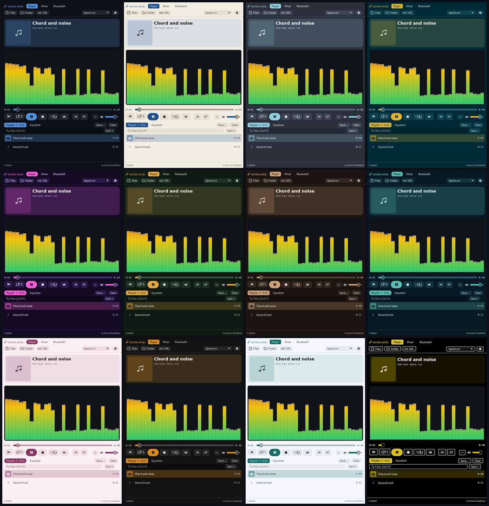

# Themes

Back to the [README](../README.md) - everything in detail: the [extended README](README-extended.md).

**Themes** for the window (⚙ → Theme), twelve, each a set of design tokens
(grounds, cards, text, secondary text, the accent with its hover and pressed
shades, borders, the focus ring, good / warning / error, a slider's rail,
selection, shadow, corners): *Midnight* (the default), *Paper* (warm white,
ink-blue), *Frost*, *Dusk* (Solarized at sundown), *Night drive* (violet,
magenta, a little cyan), *Forest*, *Espresso*, *Ocean*, *Sakura* (light pink,
plum), *Studio* (greyscale, one orange signal), *Daylight* (light) and *High
contrast* (black and white, yellow for what is chosen, a 3 px focus ring, 7 : 1
text). The pointer on one in the menu shows it at once; a click keeps it (in
axross-amp's own file). Optionally the desktop's light or dark decides (on Linux
asked of the XDG desktop portal, else GNOME's `color-scheme` - its "Default"
is light, unless the GTK theme is a dark one - else GTK's setting; winit says
nothing there; watched only while followed, on one D-Bus connection woken by
the portal's SettingChanged), between
a light and a dark theme of one's choice. The accent comes from the cover (made
to read in the theme: lightened or darkened until it does) or is the theme's
own. A test checks every theme's text, secondary, disabled and selected text,
accent, good / warning / error, the focus ring and the slider against every
ground they lie on (WCAG AA, 4.5 : 1 and 3 : 1; AAA, 7 : 1, in high contrast).
A theme changes the window, never the pictures: the faces keep their own
colour schemes (a theme only suggests one) and so every limit on flashes.
Switching costs one frame; nothing a frame.

Every theme, playing (`cargo test --test themes -- --ignored`, which also
renders each in the window's other states into a contact sheet).
